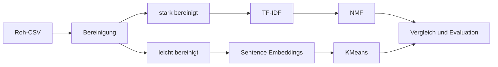

# Themenextraktion aus Bürgermeldungen der Stadt Zürich

Über das Portal [Züri wie neu](https://www.zueriwieneu.ch) melden Bürgerinnen und Bürger der
Stadt Zürich Schäden und Mängel, etwa an Strassen, Beleuchtung oder Abfallsammelstellen.
Dieses Projekt untersucht rund 80.000 dieser Meldungen mit NLP-Methoden und ermittelt, welche
Themen am häufigsten angesprochen werden.

Die Meldungen sind zwar Kategorien zugeordnet, diese richten sich aber nach der Zuständigkeit
in der Verwaltung. Ein nicht durchgesetztes Halteverbot steht zum Beispiel unter
„Signalisation/Lichtsignal“. Aus dem Freitext gewonnene Themen können zeigen, was die
Meldenden tatsächlich beschäftigt.

Hochschulprojekt im Kurs *Projekt: Data Analysis* (IU Internationale Hochschule).
Stand: Konzept abgeschlossen, Umsetzung in Arbeit.

## Daten

| | |
|---|---|
| Quelle | Stadt Zürich, Open Data: [Züri wie neu](https://www.stadt-zuerich.ch/geodaten/download/Zueri_wie_neu) |
| Lizenz | CC0 |
| Datenstand | 29.10.2026, 79.159 Meldungen von 2013 bis 2026 |
| Analysiertes Feld | `detail` (Freitext der Meldung) |

Die Rohdaten liegen nicht im Repository. Datenstand und Prüfsumme sind in
[data/README.md](data/README.md) dokumentiert.

## Befunde aus der Datensichtung

- 57 % der Texte enthalten Kodierungsfehler (`ü` statt `ü`). Sie sind systematisch und lassen
  sich vollständig reparieren.
- Die Texte sind kurz: Der Median liegt bei 8 Wörtern.
- Viele gleichlautende Texte sind keine Duplikate, sondern eigenständige Kurzmeldungen wie
  „Abfall“. Sie werden daher nicht entfernt.

## Vorgehen



Nach der Bereinigung entstehen zwei Textfassungen. Die stark bereinigte (Lemmata, ohne
Stoppwörter) wird mit TF-IDF vektorisiert und mit NMF in Themen zerlegt. Die leicht bereinigte
wird mit einem mehrsprachigen Sentence-Transformer eingebettet und mit KMeans geclustert. Die
Themenzahl wird über die Topic Coherence gewählt, die Häufigkeit eines Themas ergibt sich aus
dem Anteil der zugeordneten Meldungen.

Verwendet werden Python 3.12, pandas, ftfy, spaCy, scikit-learn, sentence-transformers, gensim,
matplotlib und seaborn.

## Projektstruktur

```
configs/      Konfiguration (Pfade, Parameter, Seed)
data/         Datendokumentation
notebooks/    Datensichtung und Ergebnisdarstellung
results/      Abbildungen und Tabellen
src/          Code für Daten, Vorverarbeitung, Vektorisierung, Themen, Evaluation
tests/        Tests
```

## Installation und Ausführung

Voraussetzung ist Python 3.12.

```bash
git clone https://github.com/elisab-code/data-analysis-zueri.git
cd data-analysis-zueri
py -3.12 -m venv .venv            # macOS/Linux: python3.12 -m venv .venv
source .venv/Scripts/activate     # macOS/Linux: source .venv/bin/activate
pip install -r requirements.txt
```

**Daten:** Die Stadt Zürich erzeugt die CSV über ein Formular auf der
[Datenseite](https://www.stadt-zuerich.ch/geodaten/download/Zueri_wie_neu), ein direkter
Download per Skript ist daher nicht möglich. Die Datei wird als
`data/raw/data-zuerich_2026-10-29.csv` abgelegt und anschließend geprüft:

```bash
python -m src.data.download
```

Das Skript vergleicht die Prüfsumme mit dem analysierten Datenstand vom 29.10.2026. Da der
Datensatz täglich aktualisiert wird, weicht ein neuerer Download ab. Mit `--allow-mismatch`
lässt er sich trotzdem verwenden, die Ergebnisse unterscheiden sich dann leicht.

**Entwicklung und Tests:**

```bash
pip install -r requirements-dev.txt
nbstripout --install              # entfernt Notebook-Ausgaben beim Commit
pytest
```

## Stand

- [x] Datenquelle und Datensichtung
- [x] Konzept
- [x] Umgebung und Datendownload
- [ ] Vorverarbeitung
- [ ] Vektorisierung
- [ ] Themenextraktion und Evaluation
- [ ] Ergebnisse und Diskussion
