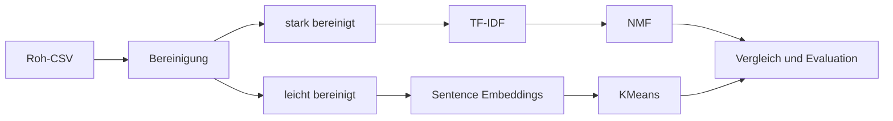
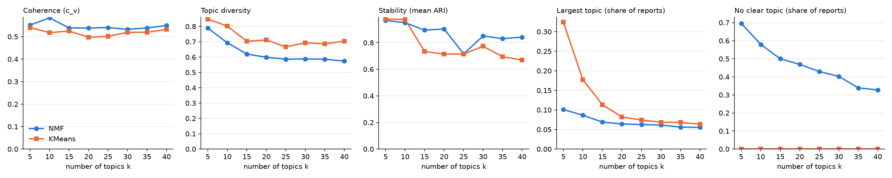

# Themenextraktion aus Bürgermeldungen der Stadt Zürich

Über das Portal [Züri wie neu](https://www.zueriwieneu.ch) melden Bürgerinnen und Bürger der
Stadt Zürich Schäden und Mängel, etwa an Strassen, Beleuchtung oder Abfallsammelstellen.
Dieses Projekt untersucht rund 80.000 dieser Meldungen mit NLP-Methoden und ermittelt, welche
Themen am häufigsten angesprochen werden.

Die Meldungen sind zwar Kategorien zugeordnet, diese richten sich aber nach der Zuständigkeit
in der Verwaltung. Ein nicht durchgesetztes Halteverbot steht zum Beispiel unter
„Signalisation/Lichtsignal“. Aus dem Freitext gewonnene Themen können zeigen, was die
Meldenden tatsächlich beschäftigt.

Hochschulprojekt im Kurs *Projekt: Data Analysis* (IU Internationale Hochschule).
Stand: Umsetzung abgeschlossen, Finalisierung folgt.

## Daten

| | |
|---|---|
| Quelle | Stadt Zürich, Open Data: [Züri wie neu](https://www.stadt-zuerich.ch/geodaten/download/Zueri_wie_neu) |
| Lizenz | CC0 |
| Datenstand | 29.10.2026, 79.159 Meldungen von 2013 bis 2026 |
| Analysiertes Feld | `detail` (Freitext der Meldung) |

Die Rohdaten liegen nicht im Repository. Datenstand und Prüfsumme sind in
[data/README.md](data/README.md) dokumentiert.

## Befunde aus der Datensichtung

- 57 % der Texte enthalten Kodierungsfehler (`ü` statt `ü`). Sie sind systematisch und lassen
  sich vollständig reparieren.
- Die Texte sind kurz: Der Median liegt bei 8 Wörtern.
- Viele gleichlautende Texte sind keine Duplikate, sondern eigenständige Kurzmeldungen wie
  „Abfall“. Sie werden daher nicht entfernt.

## Vorverarbeitung

| Schritt | Meldungen |
|---|---|
| Rohdaten | 79.159 |
| ohne Text entfernt | −2 |
| nach leichter Bereinigung leer (nur Grussformeln) entfernt | −21 |
| **verarbeitet** | **79.136** |

- **Leichte Bereinigung** (für Sentence Embeddings): Kodierung reparieren, Zeilenumbrüche
  (`<br/>`) entfernen, E-Mail-Adressen entfernen, Grussformeln entfernen, Leerraum vereinheitlichen.
- **Starke Bereinigung** (für TF-IDF): zusätzlich Lemmatisierung mit spaCy, Stoppwörter und
  Satzzeichen entfernen. Zahlen bleiben erhalten („Tempo 30“, „seit 3 Wochen“), ebenso
  Verneinungen und Zeitangaben wie „nicht“, „kein“, „seit“ und „wieder“.
- 48 Meldungen bestehen nur aus Stoppwörtern und sind nach der starken Bereinigung leer. Sie
  bleiben im Datensatz, damit beide Themenverfahren dieselben Meldungen auswerten.
- Das spaCy-Modell ist auf Texten aus deutschen Zeitungen trainiert und kennt Schweizer
  Schreibweisen nur teilweise. Deshalb wird „ß“ in den Lemmata zu „ss“, und häufige
  Fehllemmata und Tippfehler werden in [configs/config.yaml](configs/config.yaml) korrigiert
  (`lemma_fixes`, z. B. „velos“ → „velo“, „grafitti“ → „graffiti“).
- Synonyme, die dasselbe Ding bezeichnen, werden auf ein Wort abgebildet (`synonyms`, z. B.
  „müll“ und „littering“ → „abfall“, „fahrrad“ → „velo“). Zusammensetzungen behalten ihr
  Grundwort („müllsack“ → „abfallsack“), weil Abfallsäcke, Abfalleimer und Abfallhaufen
  verschiedene Anliegen sind. Ersetzt werden nur ganze Wörter, „müllerstrasse“ bleibt erhalten.
- Die Kategorie `service_code` hat nach der Kodierungsreparatur 11 Werte. Das
  Kategoriensystem hat sich über die Jahre verändert.

## Vorgehen



Nach der Bereinigung entstehen zwei Textfassungen. Die stark bereinigte (Lemmata, ohne
Stoppwörter) wird mit TF-IDF vektorisiert und mit NMF in Themen zerlegt. Die leicht bereinigte
wird mit einem mehrsprachigen Sentence-Transformer eingebettet und mit KMeans geclustert. Die
Themenzahl wird über Kohärenz, Stabilität und Abdeckung gewählt, die Häufigkeit eines Themas
ergibt sich aus dem Anteil der zugeordneten Meldungen.

Verwendet werden Python 3.12, pandas, ftfy, spaCy, scikit-learn, sentence-transformers, gensim,
matplotlib und seaborn.

## Ergebnisse

**Themenzahl: k = 10.** Bei zehn Themen erreicht NMF die höchste Kohärenz, und beide Verfahren
bilden auf verschiedenen Stichproben fast dieselben Gruppen (Stabilität 0,95 und 0,97). Ab
k = 15 sinkt die Stabilität von KMeans auf etwa 0,7, feinere Cluster hängen also stark davon ab,
welche Meldungen in der Stichprobe sind. Die Kohärenz unterscheidet sich zwischen den k kaum und
entscheidet allein nichts.



**Häufigste Themen.** Das häufigste Anliegen, das beide Verfahren finden, ist Abfall: Mindestens
jede achte Meldung betrifft illegal entsorgten oder deponierten Abfall (12,6 % bei NMF, 13,2 % bei
KMeans). Insgesamt beschreiben die zehn NMF-Themen 42 % der Meldungen eindeutig.

Die Anteile der beiden Verfahren sind unterschiedlich zu lesen. Bei NMF zählen nur eindeutig
zugeordnete Meldungen, die Werte sind also Untergrenzen. KMeans ordnet jede Meldung zu, seine
Werte enthalten deshalb auch Meldungen, die nur ungefähr passen. Anteile an allen 79.136
Meldungen ([NMF](results/tables/nmf_topics_k10.csv), [KMeans](results/tables/kmeans_topics_k10.csv)):

| Thema | NMF | KMeans |
|---|---|---|
| Verkehr und Sicherheit (Autos, Velos, Fussgänger) | – | 17,7 % |
| Abfall, illegal entsorgt oder deponiert | 12,6 % (2 Themen) | 13,2 % |
| Schäden (Löcher, kaputt, beschädigt) | 3,4 % („defekt“) | 12,7 % |
| Strassenbeleuchtung | 2,7 % | 8,2 % |
| Velos, auch herrenlose und Schrottvelos | 6,1 % (2 Themen) | – |
| Wasser, Brunnen, Abflüsse | – | 5,4 % |
| Bäume und Äste | – | 4,8 % |
| Graffiti | 4,2 % | 4,4 % |
| Möbel und Sperrmüll | 1,0 % | 3,8 % |
| Tafeln und Signale (verklebt, schräg, verdreht) | 3,6 % | – |
| gemischt oder allgemein | 8,4 % | 29,8 % (2 Cluster) |
| kein eindeutiges Thema | 58,0 % | – |

Beide Verfahren finden Abfall, Graffiti, Möbel und Beleuchtung. Bei diesen Themen landen 75 bis
89 % der Meldungen eines NMF-Themas im passenden KMeans-Cluster. Die Unterschiede folgen aus der
Arbeitsweise:

- **NMF gruppiert nach gemeinsamen Wörtern.** Themen mit eigenem Wortschatz wie Graffiti oder
  Tafeln trennt es sauber. Ein gemeinsames Wort kann aber verschiedene Gegenstände verbinden: Das
  Thema „defekt“ enthält neben anderen Schäden auch viele Lampen.
- **KMeans gruppiert nach Bedeutung.** Es findet Themen mit wechselndem Wortschatz wie Verkehr
  und Sicherheit, Wasser oder Bäume, die NMF bei k = 10 nicht zeigt. Dafür entstehen
  Sammelcluster: Einer (15,0 %) besteht vor allem aus sehr kurzen Meldungen zu verschiedenen
  Gegenständen (Median 2 Wörter).

**Wie Probleme beschrieben werden.** Eine lange Dauer („seit Wochen“) wird vor allem bei Velos
und herumstehenden Gegenständen genannt (24 % im NMF-Velothema, 26 % im KMeans-Cluster „stehen,
liegen“, insgesamt 9,5 %). Gefährdung kommt am häufigsten im KMeans-Cluster Verkehr und
Sicherheit vor (19 %, insgesamt 6,0 %), bei Graffiti, Abfall und Möbeln fast nie (unter 1 %).
Wiederholung („immer wieder“) ist bei Abfall und Verkehr mit 7 % am häufigsten (insgesamt 3,9 %).

**Grenzen.**

- Für 58 % der Meldungen gibt es kein NMF-Thema, das sie eindeutig beschreibt. Sie sind nicht
  kürzer als die übrigen, verwenden aber vermutlich einen vielfältigeren Wortschatz: KMeans ordnet
  sie vor allem Verkehr und Sicherheit, Schäden und den Sammelclustern zu. Auch mit 40 Themen
  bleiben es 33 %, mit einer halb so hohen Schwelle (0,05) noch 47 %.
- KMeans ordnet jede Meldung zu, auch wenn sie in kein Cluster gut passt. Die Anteile wirken
  dadurch genauer, als sie sind.
- Die Kohärenz misst nur, ob Themenwörter gemeinsam vorkommen. Ob ein Thema verständlich ist,
  zeigen erst Beispieltexte ([Notebook 03](notebooks/03_topics.ipynb), Abschnitt E5).
- Die Zustandsmerkmale beruhen auf Wortmustern, ihre Treffsicherheit ist noch nicht an einer
  Stichprobe geprüft.

## Projektstruktur

```
configs/      Konfiguration (Pfade, Parameter, Seed)
data/         Datendokumentation
notebooks/    Datensichtung und Ergebnisdarstellung
results/      Abbildungen und Tabellen
src/          Code für Daten, Vorverarbeitung, Vektorisierung, Themen, Evaluation
tests/        Tests
```

## Installation und Ausführung

Voraussetzung ist Python 3.12.

```bash
git clone https://github.com/elisab-code/data-analysis-zueri.git
cd data-analysis-zueri
py -3.12 -m venv .venv            # macOS/Linux: python3.12 -m venv .venv
source .venv/Scripts/activate     # macOS/Linux: source .venv/bin/activate
pip install -r requirements.txt
```

`requirements.txt` legt die direkt verwendeten Pakete fest. Exakt dieselbe Umgebung wie bei
der Analyse, einschließlich aller indirekt installierten Pakete, ergibt
`pip install -r requirements-lock.txt` (erstellt mit `pip freeze`).

**Daten:** Der analysierte Datenstand vom 29.10.2026 liegt als
[Release](https://github.com/elisab-code/data-analysis-zueri/releases/tag/data-2026-10-29)
vor. Das Skript lädt ihn nach `data/raw/` und prüft die Prüfsumme:

```bash
python -m src.data.download
```

Neuere Daten gibt es über das Formular auf der
[Datenseite der Stadt Zürich](https://www.stadt-zuerich.ch/geodaten/download/Zueri_wie_neu).
Da der Datensatz täglich aktualisiert wird, weicht ihre Prüfsumme ab. Mit `--allow-mismatch`
lassen sie sich trotzdem verwenden, die Ergebnisse unterscheiden sich dann.

**Vorverarbeitung** (ca. 2 Minuten):

```bash
python -m src.preprocessing.pipeline
```

Das Skript schreibt die bereinigten Texte nach `data/processed/reports.parquet` und legt
in `data/processed/preview.csv` eine Stichprobe von 200 Meldungen zum Ansehen ab.

**Vektorisierung** (beim ersten Lauf ca. 15 Minuten auf der CPU):

```bash
python -m src.vectorization.pipeline
```

Das Skript berechnet die Sentence Embeddings und speichert sie in `results/cache/`. Spätere
Schritte laden sie von dort. Ändern sich die Texte oder das Modell, wird neu gerechnet. Der
Vergleich der beiden Vektorisierungen steht in
[notebooks/02_vectorization.ipynb](notebooks/02_vectorization.ipynb).

Das Embedding-Modell
[paraphrase-multilingual-MiniLM-L12-v2](https://huggingface.co/sentence-transformers/paraphrase-multilingual-MiniLM-L12-v2)
(Lizenz Apache 2.0) liegt nicht im Repository. Beim ersten Lauf lädt das Skript es vom
Hugging Face Hub herunter (ca. 460 MB, ohne Konto und kostenlos) und speichert es lokal unter
`~/.cache/huggingface/`. Die Modellversion ist in [configs/config.yaml](configs/config.yaml)
als Commit festgelegt (`revision`). Die Texte werden lokal verarbeitet und nicht übertragen.
Liegt das Modell bereits im lokalen Speicher, läuft das Skript mit `HF_HUB_OFFLINE=1` auch
ohne Internetverbindung.

**Themenextraktion** (ca. 1–2 Minuten):

```bash
python -m src.topics.pipeline            # Themenzahl aus der Config
python -m src.topics.pipeline --k 12     # andere Themenzahl
```

Das Skript extrahiert Themen mit NMF (auf TF-IDF) und KMeans (auf den Embeddings) und schreibt
pro Verfahren eine Tabelle mit Themenwörtern und Anteilen nach `results/tables/`. Ein erster
Blick auf die Themen steht in [notebooks/03_topics.ipynb](notebooks/03_topics.ipynb).

Themen beschreiben, *was* gemeldet wird (den Gegenstand). *Wie* ein Problem beschrieben wird,
erfassen drei Zustandsmerkmale (`states` in der Config): Dauer („seit 3 Wochen“, 9,5 % der
Meldungen), Wiederholung („immer wieder“, 3,9 %) und Gefährdung („gefährlich“, 6,0 %). Die
Tabellen zeigen pro Thema den Anteil der Meldungen mit dem jeweiligen Merkmal. Damit
Zustandswörter wie „seit“ oder „nicht“ keine eigenen Themen bilden, sind sie keine
TF-IDF-Merkmale, ebenso Wörter über die Meldung selbst („bitte“, „foto“) und reine Zahlen
(`tfidf.exclude_words`, `tfidf.exclude_numbers`). Wortpaare mit Zahl wie „tempo 30“ bleiben.

NMF ordnet eine Meldung nur dann einem Thema zu, wenn das Thema einen ausreichenden Teil ihres
TF-IDF-Vektors beschreibt (`topics.nmf.min_weight`). Die übrigen Meldungen erscheinen als
„kein eindeutiges Thema“. KMeans ordnet jede Meldung dem nächsten Cluster zu.

**Wahl der Themenzahl** (ca. 20 Minuten):

```bash
python -m src.evaluation.k_scan              # k = 5, 10, ..., 40 aus der Config
python -m src.evaluation.k_scan --k 10 20    # nur diese Werte
```

Das Skript berechnet für beide Verfahren und jedes k die Kohärenz (c_v), die Themenvielfalt,
die Stabilität über Stichproben (mittlerer ARI), den Anteil des größten Themas und den Anteil
der Meldungen ohne eindeutiges Thema. Ergebnis: `results/tables/k_scan.csv` und
`results/figures/k_scan.png`.

**Entwicklung und Tests:**

```bash
pip install -r requirements-dev.txt
nbstripout --install              # entfernt Notebook-Ausgaben beim Commit
pytest
```

## Stand

- [x] Datenquelle und Datensichtung
- [x] Konzept
- [x] Umgebung und Datendownload
- [x] Vorverarbeitung
- [x] Vektorisierung
- [x] Themenextraktion und Evaluation (k = 10)
- [x] Ergebnisse und Diskussion (erste Fassung)
- [ ] Finalisierung
